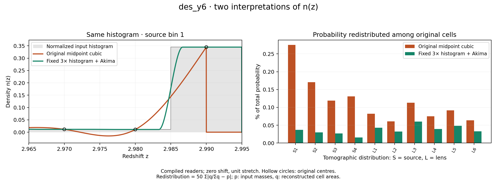

# Data-vector checks <a name="data-vector"></a>

These checks compare every entry of the shipped 1,300-entry prediction and
exercise cache invalidation, input validation and probe selection. The active
likelihood has a dummy vector and identity covariance; the checks do not
validate a measured DES Y6 likelihood.

| Check | Configuration |
|---|---|
| Full-vector reference comparison | 3×2pt, IA modeling: NLA |
| Full-vector reference comparison | 3×2pt, IA modeling: TATT |
| Full-vector reference comparison | Cosmic shear, IA modeling: NLA |
| Full-vector reference comparison | Cosmic shear, IA modeling: TATT |
| Return to the original prediction after parameter changes | IA modeling: NLA |
| Return to the original prediction after parameter changes | IA modeling: TATT |
| Agreement with a fresh process | IA modeling: NLA |
| Agreement with a fresh process | IA modeling: TATT |
| Retained entries agree with the full prediction | Clustering and galaxy–galaxy lensing |
| Retained entries agree with the full prediction | Cosmic shear and clustering |
| Retained entries agree with the full prediction | Cosmic shear and galaxy–galaxy lensing |
| Linear-power option returns a finite, distinct prediction | Cosmic shear |
| n(z) setting changes and restoration | Photo-z interpolation and coordinate convention |
| Invalid data, mask or covariance indices are rejected | Temporary input files |
| A thread key in the covariance YAML is rejected | OpenMP threads belong to the environment |
| Stored input hashes and descriptor layout are checked | `manifest_sha256.json` |
| The TATT reference differs from NLA in shear and galaxy–galaxy lensing, not in clustering | Stored reference vectors |
| Separate accuracy-control refinements | NLA and TATT, every vector entry |
| Non-Limber gg/gs switches and restoration | NLA and TATT, selected block only |
| Public hybrid YAMLs on CPU | 3×2pt NLA and cosmic-shear TATT |
| External BCEmu suppression and restoration | Same Takahashi baseline, all probes |

We assume the project is enabled in `set_installation_options.sh` and
compiled, the Cocoa Conda environment is active, the shell is Bash, and the
current folder is `cocoa/Cocoa/`. Test workers
use four OpenMP threads and one BLAS thread. The optional-model checks need
the shared hybrid emulator assets and BCEmu installed through the
[main Cocoa recipe](https://github.com/CosmoLike/cocoa#cobaya_base_code_examples_emul2).
A missing dependency is a failure with an explicit error, not a silent skip.

## Running the data-vector checks <a name="run-data-vector"></a>

**Step :one:**: activate Cocoa's private environment.

```bash
source start_cocoa.sh
```

**Step :two:**: run the data-vector checks.

```bash
python -m pytest ./projects/des_y6/tests/data_vector
```

## Accuracy and model-choice checks

`test_accuracy.py` changes each control separately in a fresh process:
`accuracyboost`, `integration_accuracy`, `pk_z_refinement`,
`nonlimber_accuracyboost` and, for TATT, `internal_accuracyboost`. The default
must reproduce its frozen vector. Refined vectors must be finite; per-probe
maximum absolute and peak-normalized changes are printed as diagnostics.
The dummy identity covariance cannot supply a meaningful survey chi-squared
accuracy threshold, so the test does not invent one.

`test_nonlimber.py` switches gg or galaxy–shear projection individually,
checks that only the selected block changes, then requires exact restoration.
This tests the switch and cache behavior, not non-Limber convergence.

`test_optional_models.py` evaluates both public CPU hybrid configurations.
It also applies BCEmu off/on/off restoration against the same
gravity-only Takahashi spectrum, checking every probe. No frozen reference
is regenerated, and no HMcode feedback is mixed with the external ratio.

<a name="nz-reconstruction"></a>
### Two interpretations of histogram n(z)

Every likelihood default YAML exposes `photoz_histogram_akima: 0`:

- **0 — original midpoint curve:** keeps the existing reconstruction. With the default `photoz_interpolation_type: 0`, a natural cubic passes through the histogram-bin centres before the uniform lookup is prepared.
- **1 — 3× histogram + Akima:** first represents each uniform input bin by three equal-density cells, then fits Akima through their centres. For irregular bins, the preparation cells receive overlap-weighted average densities. Both source and lens samples use the choice; the separate cluster-redshift model is unchanged.

**Step :one:**: Set the reconstruction and the tested integration level inside the chosen likelihood's YAML block:

```yaml
photoz_histogram_akima: 1
integration_accuracy: 0
```

The test uses level 0 for a software comparison. Its identity covariance cannot establish a statistically adequate integration level. The level-6 comparison below is an arithmetic diagnostic only.

The **first factor three is hardcoded** and independent of every accuracy boost. It retains the original centre and adds points at one-sixth and five-sixths of each uniform bin. The default second stage subdivides each Akima polynomial in two; it does not refit a natural cubic. Runtime queries evaluate these same Akima polynomials by direct uniform-grid indexing, without a binary search. `photoz_interpolation_type` controls only mode 0; `photoz_zmid_convention` still controls how input coordinates are interpreted in both modes.

The figure uses this project's **compiled readers and stored input histogram**. The left panel overlays both reconstructions at the same bin edges; the right panel compares original-bin probability redistribution for every source/lens distribution.



**Data-vector comparison.** [`test_nz_reconstruction.py`](test_nz_reconstruction.py) uses the stored NLA fiducial, mask and covariance. The reconstruction difference and the quadrature error are separate measurements:

| Setting | Value |
|---|---:|
| `accuracyboost` | 1 |
| Test `integration_accuracy` | 0 |
| Reference `integration_accuracy` | 6 (4096 points per Limber panel) |

| Numerical distance from the 4096-point reference | $\Delta\chi^2$ |
|---|---:|
| Original curve at the test level | 1.98808e-06 |
| Akima curve at the test level | 3.69576e-05 |
| Difference between the curves at the test level | 4.41888e-05 |

| Quantity | Result |
|---|---:|
| $\Delta\chi^2$ between Akima and original, refined reference | 1.031e-06 (identity-covariance software distance) |
| $\Delta\chi^2$ between Akima and original, test level | 0.000054 |
| Selected data-vector entries | 1300 |
| Return to mode 0 after 0 → 1 → 0 | Bitwise identical |
| YAML mode 1 versus live native selection | Bitwise identical |

The model distance is

```math
\Delta\chi^2 = (d_{\mathrm{Akima}}-d_{\mathrm{original}})^T C^{-1} (d_{\mathrm{Akima}}-d_{\mathrm{original}}).
```

It is not the difference between the two chi-square values against the observed data. **DES Y6 uses an identity covariance here. This number is a software diagnostic, not a survey Δχ² or a statement about observational significance.**

At the same fiducial, increasing integration_accuracy from 5 to 6 changes the original vector by Δχ² = 4.99249e-14, and the Akima vector by Δχ² = 1.14933e-09. These are within-interpretation quadrature distances, separate from the model difference above.

**What happens to probability?** Histogram normalization happens before the smooth reconstruction. The original cubic need not preserve its final total area. Three repeated values per uniform bin, with the chosen endpoint padding, make the Akima total agree with one to rounding in this audit; this is not a general guarantee for irregular input grids. Both curves redistribute area between original bins. A smaller redistribution alone does not establish which smooth interpretation is physically correct.

| Maximum over this project's source/lens distributions | Original midpoint cubic | 3× + Akima |
|---|---:|---:|
| Probability redistributed among original cells | 0.275104% | 0.059973% |
| Absolute total-area error | 0.260037% | 1.78e-13% |

For normalized input-bin masses p and integrated reconstructed areas q, the redistribution measure is 50 Σ|q/Σq − p| percent; total-area error is 100 |Σq − 1| percent. The first measure removes overall normalization **only for this diagnostic**. The production reader receives no extra area correction. Areas are integrated with zero photo-z shifts, unit lens stretch and the default final-grid factor five, splitting at every polynomial knot. Two- and four-point rules agree within 2×10⁻¹³ in each cell.

The frozen inputs contain 18 negative density cells across the source/lens tables. This test retains them in both arms; it does not silently clip or rewrite the supplied files. Their signed areas are included in the audit.


We assume users are in `Cocoa/` with its Conda environment active.

**Step :one:**: Load the Cocoa environment.

```bash
source start_cocoa.sh
```

**Step :two:**: Run the comparison.

```bash
python -m pytest -s projects/des_y6/tests/data_vector/test_nz_reconstruction.py
```

**Step :three:**: Recreate the figures from the saved measurements.

```bash
python projects/des_y6/tests/generate_nz_reconstruction_figures.py
```

The test asserts selection, finite outputs, unchanged covariance and exact cache round trips; it prints the measured model distance without imposing a preferred physical reconstruction. Set `COCOA_NZ_REPORT_DIR` to save fresh full-precision vectors and the probability audit. To reproduce the refined reference, rerun with `COCOA_NZ_INTEGRATION_ACCURACY=6` and a different output directory; the test defaults to level 0. The figure command reads the committed [measurement record](../nz_reconstruction.json) and [probability arrays](../nz_probability_data.npz), so it does not rerun cosmology. These data-vector checks use a fixed covariance; they do not validate coarse covariance-integration settings for the alternative n(z).


# Appendix <a name="appendix"></a>

## FAQ: Which inputs are tested? <a name="inputs"></a>

The tests store their own configuration and input snapshots in `frozen/`.
The generator copies the active descriptor with the inputs it references
and the two evaluate YAMLs, writes the resolved configurations, reference
vectors and synthetic data vectors, then records the hash of every file
under `frozen/` in `tests/manifest_sha256.json`. Every data-vector
evaluation verifies this manifest; the hybrid and BCEmu checks verify it
too but evaluate the live project inputs.

The active layout has four source bins, six lens bins and 26 angular bins.
Its 1,300-entry identity covariance supplies no survey weighting. The separate
1,690-entry `data/DESY6.cov` and optional `DESY6.mask` are not selected by the
active descriptor and are excluded from the snapshot. No verified mapping
allows that covariance to be cropped into the active layout.

Input-validation tests create temporary malformed files and pass them to
the likelihood's layout validator directly: short data vectors or masks,
a reordered mask, negative, out-of-range, fractional or non-finite
covariance indices, and missing or duplicated diagonals. The likelihood
runs the same validator before the C++ reader is called.

## FAQ: What do the reference comparisons mean? <a name="references"></a>

NLA and TATT each have a stored fiducial vector for each example. Each
example stores one resolved configuration, in NLA; the tests switch it to
TATT when they load it. The 3×2pt predictions in NLA and in TATT serve as
the test data vectors of the two models. The tests compare data vectors,
not $`\chi^2`$: `frozen/reference_chi2.json` is stored, but no test reads
it. This checks reproducibility at a known point; a raw $`\chi^2`$ against
these vectors has no measured-survey interpretation.

| Comparison | Requirement |
|---|---|
| Every stored data-vector entry | Relative tolerance `1e-8`, absolute tolerance `1e-14` |
| Same-process cache return | Bitwise agreement |
| Fresh-process data vector | Bitwise agreement |

These are software regression guards, not DES Y6 accuracy requirements.
Assessing physical accuracy needs an appropriate covariance and independent
interpolation, quadrature and model checks. Passing the reduced covariance
assembly test does not establish those conditions.

The [validation record 20261007.json](../validation/20261007.json) preserves
the build checks, full-matrix comparisons, notebook fingerprints and their
scope for project commit 868b17f. Its source and notebook hashes describe
that revision: they do not match the current notebooks, and the module
`interface/des_y6_notebook.py` it fingerprints is not part of the current
project.

The [example and accuracy validation record](../validation/hybrid_accuracy_20261007.json)
records 35 data-vector checks and the separate covariance adapter check, with
the source hashes of project commit 27e745c.

## FAQ: How can users replace a reference? <a name="replace-reference"></a>

Only the documented generator writes the reference state and its manifest.
Replace them after reviewing an intended physics or input change, never to
hide an unexplained failure. If that is the case, follow the steps below.

We assume the project is enabled in `set_installation_options.sh` and
compiled, the Cocoa Conda environment is active, the shell is Bash, and the
current folder is `cocoa/Cocoa/`.

**Step :one:**: activate Cocoa's private environment.

```bash
source start_cocoa.sh
```

**Step :two:**: regenerate the reference vectors and manifest.

```bash
python ./projects/des_y6/tests/generate_frozen_reference.py --overwrite
```

**Step :three:**: inspect the reference changes.

```bash
git -C ./projects/des_y6 diff -- tests/frozen tests/manifest_sha256.json
```

**Step :four:**: rerun the data-vector checks.

```bash
python -m pytest ./projects/des_y6/tests/data_vector
```

The generator preserves previous references in the ignored
`tests/.reference_backups/` folder. Use the [separate covariance flow](../covariance/README.md)
when the change also affects covariance calculations.
