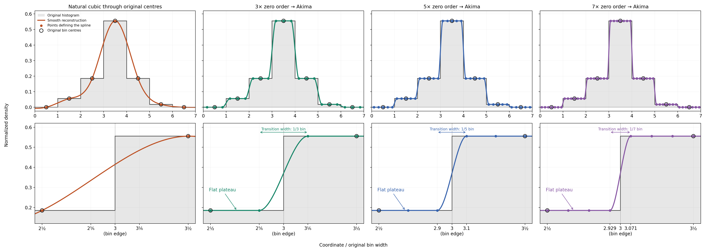

# Histogram reconstruction study

## :interrobang: FAQ: What are optional studies? 

This guide illustrates the n(z) reconstruction choices. DES Y6 has no
statistical $\Delta\chi^2$ study because its supplied identity matrix is not
a physical survey covariance.

## Histogram reconstructions

The source/lens reconstruction options are available in every likelihood YAML:
`photoz_histogram_akima: 0` keeps the original midpoint curve; value `1` selects
Akima after fixed `photoz_histogram_akima_factor: 3`, `5` or `7` preparation.
Both paths always use uniform-grid lookup. The first factor never changes
with numerical accuracy.

The preparation points lie at these fractions of each original bin width,
measured from its left edge:

| Preparation factor | Point positions within each bin |
|---|---|
| 3 | 1/6, 1/2, 5/6 |
| 5 | 1/10, 3/10, 1/2, 7/10, 9/10 |
| 7 | 1/14, 3/14, 5/14, 1/2, 9/14, 11/14, 13/14 |

All three factors retain the original bin centre. More points narrow the
smoothed edge; all three Akima curves still redistribute probability between
bins.
